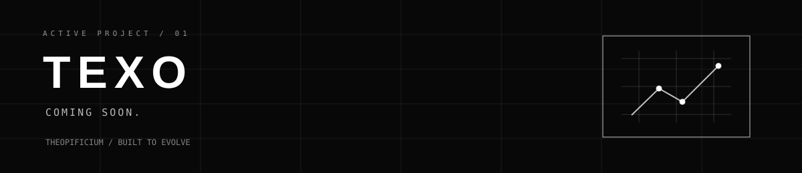

<h1 align="center">
  
</h1>

<p align="center">
  <a href="#active-projects"><strong>PROJECTS</strong></a>
  &nbsp;&nbsp;·&nbsp;&nbsp;
  <a href="#engineering-principles"><strong>PRINCIPLES</strong></a>
  &nbsp;&nbsp;·&nbsp;&nbsp;
  <a href="#build-standards"><strong>STANDARDS</strong></a>
  &nbsp;&nbsp;·&nbsp;&nbsp;
  <a href="#design-system"><strong>DESIGN SYSTEM</strong></a>
</p>

<p align="center">
  Software development company focused on robust, modular and maintainable systems.
</p>

---

## What we build

TheOpificium designs and engineers software intended to survive beyond the first release.

We care about clear boundaries, explicit interfaces, maintainability, automation and systems that can evolve without becoming incomprehensible.

```text
ideas → model → build → test → ship → evolve
```

## Active projects

### TEXO



**Coming soon.**

## Engineering principles

| | Principle | Meaning |
|---|---|---|
| `01` | **Precise** | Clear contracts, explicit behavior and measurable outcomes. |
| `02` | **Modular** | Components have boundaries and can evolve independently. |
| `03` | **Crafted** | APIs, DX, naming, documentation and failure modes matter. |
| `04` | **Engineered** | Reliability and scalability are designed into the system. |
| `05` | **Open** | Prefer understandable systems, portable standards and useful documentation. |

## Build standards

```text
architecture   → domain first
interfaces     → explicit + versionable
delivery       → automated + reversible
quality        → behavior at the right boundary
documentation  → record decisions, not noise
security       → architecture concern, not an afterthought
```

## Design system

**Coming soon.**

---

<p align="center">
  <code>PRECISE</code> · <code>MODULAR</code> · <code>CRAFTED</code> · <code>ENGINEERED</code> · <code>OPEN</code>
</p>

<p align="center">
  <strong>TheOpificium</strong> — Built to Evolve.
</p>
